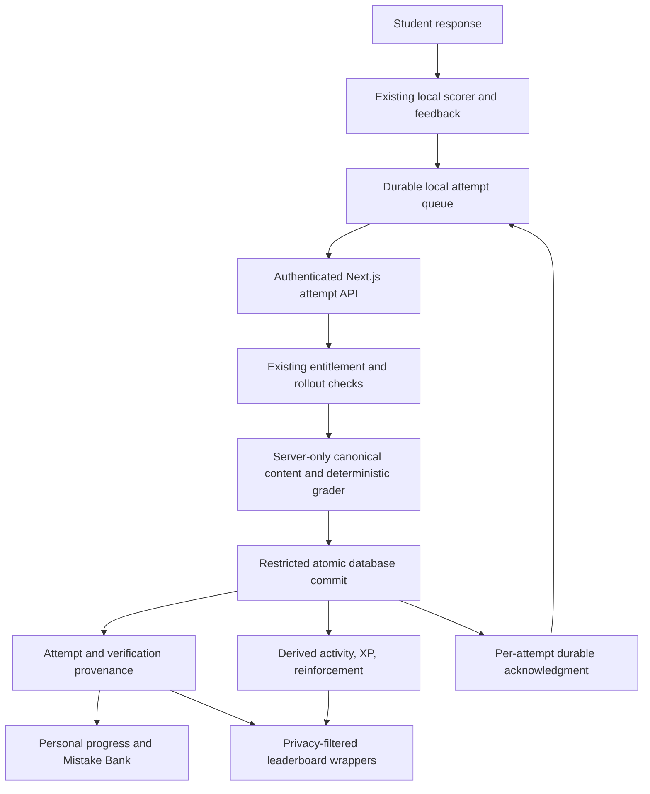

# Phase 3H: trusted grading and competitive integrity architecture

Date: 2026-10-15. **RECOMMENDED ARCHITECTURE READY FOR APPROVAL.**

This approves a design for review, not implementation, migration, or deployment. No application source, migration, dataset, permission, environment, or production data was changed. No tests, browser automation, security scanners, Git commands, or production queries were run. The only writes are this report, documentation handoff/status updates, and documentation backups.

## Recommendation and scope

Use **Option A, a Next.js server-verified attempt API, with Option C's local-first delivery model**. Grade against the existing static question files. Persist each accepted answer and its derived rewards atomically through a server-only database entry point. Close every competing write path. Keep local feedback, matching selections, Mistake Bank, adaptive scheduling, and offline sessions available.

Do not move 4,441 questions into Supabase. Do not introduce Redis, a broker, a worker service, new entitlement rules, or client-accessible answer-key endpoints. Preserve reward amounts and ranking formulas. Change the authority and eligibility of their inputs, with an explicit legacy transition.

A grading endpoint alone is insufficient. The minimum complete boundary includes session completion, timestamps, all XP writers, retry acknowledgments, and trusted-versus-legacy provenance. The design below includes one small session table and narrowly justified attempt provenance fields. These are proposed changes only.

**Security guarantee:** an accepted future verified result reflects an authorized canonical question and a response graded by the server; a replay cannot create another award. This is not proof of human effort. Authorized learners already receive answers and rationales. They can submit known correct responses or automate legitimate-looking new sessions. Preventing all automation, answer copying, omitted offline mistakes, or intentional repeat farming would require additional assessment/reward policies. No such guarantee or scoring change is implied.

## Evidence and correction to Phase 3G

Start evidence: `docs/phase3g/REPORT.md`, `docs/phase3g/ANTIGRAVITY_HANDOFF.md`, `STATUS.md`, `AGENT_HANDOFF.md`. Historical database evidence: `scratch/phase3e_targeted_supabase_schema_verification.md`. Its function bodies, constraints, and privileges are historical observations, not a fresh production inspection.

**Correction:** Phase 3G identified direct attempt-table writes as a bypass candidate based on early grants. Later `supabase/migrations/202609030006_leaderboards_v1.sql:205` revokes authenticated INSERT/UPDATE/DELETE on `question_attempts`, `daily_activity`, and `activity_events`; it also revokes writes on `user_progress` and `user_achievements`. Own-row RLS policies remain, but a policy does not itself grant table access. Therefore direct attempt insertion or correction updates are **not confirmed available under the intended complete migration chain**. Effective live table/column/inherited grants and alternative writers still require confirmation. Earlier reports remain preserved as history; this finding supersedes that inference.

Reused content baseline, without another collection audit: Harr 1,593, Ciulla 1,890, Rodak 491, Strasinger 467; total 4,441. The Phase 3G matching manifest identifies exactly 16 current runtime matching questions. No dataset or asset was edited or revalidated in this phase.

## A. Current architecture and trust boundaries

All paths below are repository-relative to `C:/Users/mypc/Desktop/Projects/RevIT`.

| Stage | Exact source and function | Authority, bypass, and retry behavior |
|---|---|---|
| Answer selection | `app/RevITApp.tsx`, `submitAnswer`, `completeQuestion`, choice click handler | Browser-controlled. Shuffled display maps back to canonical `choiceIndex`; do not grade the displayed position. Browser lock prevents accidental double clicks only. |
| Local grading | `app/lib/matchingQuestion.ts`, `isQuestionAnswerCorrect`, `encodeMatchingAnswers` | No server involved. Ordinary index equals `correctAnswer`; matching encoding equals encoded `matching.answerKey`. A malicious client can replace both response and boolean. |
| Attempt creation | `app/RevITApp.tsx:2152`, `completeQuestion` | Browser generates UUID, timestamp, session UUID, metadata, correctness, repeat flag, and local attempt number. Identity from UI state is not database authority. |
| Local reinforcement | `app/lib/adaptiveQuestions.ts`, `reinforcementLevelAfterAnswer`, `reinforcementAfterAnswer`, `chooseAdaptiveQuestion` | Wrong increments to maximum 3; correct clears to 0. Local weights, history, randomness choose subsequent questions. This is study scheduling, not proof of correctness. |
| Queuing and persistence | `app/lib/cloudService.ts`, `queueQuestionAttempt`, `flushQuestionAttemptQueue`, `migrateLocalQuestionAttempts`, `saveQuestionAttempt` | Stable IDs retained in localStorage. Actual transport is one RPC per attempt, despite the batching scheduler's name. Matching values become NULL only at the sender. Sender acknowledgment requires a returned row. |
| Database attempt | `supabase/migrations/202610130023_strasinger_book_edition_support.sql:32`, `record_question_attempt`; historical predecessor in Migration 22 | SECURITY DEFINER uses `auth.uid()` for owner. Stores caller correctness. Checks nonempty/length-limited IDs, not canonical existence or Pro entitlement. Prefix metadata determines book. Future timestamp clamped; past dates unrestricted. Stable ID lookup precedes per-user/question advisory lock. Duplicate concurrent requests can miss the early lookup; unique constraints prevent duplicate rows but one request can error rather than return the original row. No runtime concurrency test claimed. |
| Cloud scheduling | `app/RevITApp.tsx`, `flushBatchedCloudSync`, `scheduleBatchedCloudSync`, `persistProgressEvents`, `recordStudyEvent` | Attempts, reinforcement, then activity events. Attempts flush returns a remaining count that caller does not inspect. A failed attempt can therefore be followed by its event submission. |
| Activity and XP | `app/lib/xpService.ts`, `recordCloudProgressEvents`, `flushCloudProgressEventQueue`; `supabase/migrations/202610010013_graceful_study_activity.sql`, `record_study_activity(text,text)` | SQL verifies owned attempt/event references, but trusts their underlying content. Fixed reward amounts, not request `xp`. Event key uniqueness suppresses exact duplicates. Missing attempt returns false; current client ignores boolean and can remove the event. This risks lost legitimate credit. |
| Cloud reinforcement | `app/lib/cloudService.ts:491`, `saveQuestionReinforcement`; `supabase/migrations/202608210002_question_reinforcement.sql` | Direct own-user upsert/delete; authenticated CRUD explicitly granted under RLS. No separate grading RPC. Client levels are not authoritative mastery or reward evidence. |
| Personal analytics | `app/lib/weaknessAnalytics.ts`, `calculateTopicMastery`, `calculateTrend`; `app/RevITApp.tsx`, `normalizeAttempts`, `mergeAttempts` | Derived locally from attempts and `correct`. Phase 3G proved local encoded selection wins over cloud NULL on ID merge. That merge must not override future server correctness/provenance. |
| Achievements | `supabase/migrations/202608300005_level_achievements_v1.sql`, `check_and_unlock_achievements` | Computes from daily activity, exams, and event counts; unlock key `(user_id,achievement_id)` prevents duplicate reward. Its inputs can inherit forged attempts/session events. |
| Additional XP RPC | `supabase/migrations/202610080020_gamified_progression.sql:32`, `record_progression_award` | Caller supplies arbitrary positive amount, source, source ID, global award key. SECURITY DEFINER adds amount to `user_progress`; no evidence validation. Explicit authenticated EXECUTE; no PUBLIC revoke in that migration. Anonymous call returns false when `auth.uid()` is NULL. No app caller found in inspected `app/` sources; an exposed RPC need not have a UI caller to be exploitable. |
| Local missions | `app/lib/progression/progressionEngine.ts`, `evaluateProgression`, `awardXpIfEligible`; `missionsCatalog.ts`, `milestonesCatalog.ts` | Browser-only ledger and metrics; localStorage idempotency is editable. Flashcard counts are inferred from reinforcement, and study minutes from activity counts. These do not prove actual flashcard work or elapsed time. No `record_progression_award` call found here. |
| Rankings | Migration 23 `leaderboard_metric_rows`; `supabase/migrations/202610040016_database_scaling.sql`, `get_leaderboard_snapshot`; Migration 11 `get_leaderboard`, `get_current_user_leaderboard_position`; `app/lib/leaderboardService.ts` | Questions/accuracy use first attempt per user/question/day. Study XP sums `activity_events.leaderboard_xp`, **not** `user_progress.total_xp`. Snapshot additionally displays total XP from user_progress. Public wrappers honor opt-in/minimums. Historical Phase 3E reported exposed raw helpers; prepared Migration 24 has not been executed here. |

### Current reward semantics

`app/lib/xpConfig.ts` and SQL define 5 XP per correct attempt, 20 per completed session, 10 daily streak, 10 first AI message, and 10 first exam. Existing achievement rewards come from their catalog. Do not silently change these constants.

`record_study_activity` gives personal XP for **every correct attempt**, including repetitions. Competitive answer XP is 5 only when the correct attempt is the first attempt for that question that day. A first wrong answer followed by a correct repetition gives personal XP but no first-daily competitive answer XP. Questions and accuracy also use the first attempt, not the first correct attempt. Daily streak reward is deduplicated by date key; there is no general daily XP ceiling in this RPC.

Session reward currently requires only one owned attempt with the supplied session ID. The database does not prove completion. Client completion uses `sessionCanFinish`: strict sessions require all planned questions; adaptive sessions require the dynamic target, which increases for incorrect answers, plus full pool coverage when configured. Session UUIDs and the plan exist only in browser state.

Skip (`skipQuestion`) reorders/defer questions; it creates no answer attempt or answer reward. Timeout (`handleQuestionTimeout`) creates NULL/incorrect. Repetition does not change grading; it changes scheduling and repeat metadata. Adaptive review uses the same correctness function.

Leaderboard timezone is `Asia/Manila`; accuracy eligibility minimums are 20 daily, 75 weekly, 200 all-time. Preserve these, rounding, ranking/tie ordering, opt-in rules, and book/subject filters. First-daily logic based on caller dates allows backdating to create artificial daily histories. Late insertion can also change the earliest row after rewards were awarded; separate RPC transactions do not make reward and attempt ordering atomic.

### Existing authoritative content and question types

| Runtime form | Current grading | Trusted grading design |
|---|---|---|
| Single-choice MCQ | Canonical index equals `correctAnswer` | Validate integer/range from actual choices; compare server key. |
| Matching | Complete selections encoded in base `choices.length`; all-or-nothing exact key | Accept ordered integer array, exact item count, each within canonical choice range; use existing encoder/scorer server-side. No client correctness. |
| Classification / table choices | `QuestionChoiceTable.tsx` selects a row index; ordinary scorer compares key | Same canonical-index validation. If a classification item is represented as matching, use matching metadata. No new semantic parser. |
| Numerical/calculation | Current `ReviewerQuestion` has choices and `correctAnswer`, no free numeric-response/tolerance contract | Grade selected option, not numeric strings, units, or an LLM calculation. Free numeric input would require a separately specified schema. |
| True/False | Choices and ordinary correct index | Same actual-choice-count validation; do not assume four options. |
| Repeated incorrect / adaptive | Same scorer on each response | Same server scorer. Derive reward eligibility from accepted history, not `isAdaptiveRepeat`. |

`app/content/reviewerContent.ts` imports Harr JSON and exports `harrQuestions`. `app/lib/server/{ciulla,rodak,strasinger}ServerContent.ts` already import their JSON using `server-only`. Their `/api/reviewer/{ciulla,rodak,strasinger}` GET routes validate `auth.getUser()` and `get_my_entitlement`, require effective Pro, and return private/no-store payloads. All four datasets can support server grading without database question storage. Build a server-only ID map and metadata lookup from these authoritative files. The reviewed runtime type/dispatch supports two scoring forms; this phase did not rescan every prompt to infer educational categories.

`app/lib/entitlements.ts`, `QUESTION_BANKS`, already defines Harr Free and the other three Pro. Use it and the existing server entitlement result. Do not trust submitted book/subject/type, prefix alone, browser plan, or a NEXT_PUBLIC flag. Canonical lookup determines the book before authorization. Keep Strasinger writes disabled on the server as well as the existing client gate until separately approved.

### Confirmed source risks versus live unknowns

| Severity | Finding and impact | Production release effect |
|---|---|---|
| High | Authenticated attempt RPC accepts forged correctness, fictitious IDs, forged metadata, and Pro attempts without entitlement verification. Affects progress and competition. | Blocks trusted-results release. |
| High | `record_progression_award` accepts arbitrary positive XP and caller keys. Can inflate total XP; global keys also permit cross-user award-key collisions. Does not directly write leaderboard study-XP events. | Blocks XP-integrity release even with a grading API. |
| High | Client session UUID plus one attempt earns completion XP. Past timestamps manufacture daily activity/streaks and affect first-daily metrics. | Blocks competitive-integrity release. |
| High | Raw helper exposure documented historically may bypass wrapper privacy. Current effective access unknown; Migration 24 only prepared. | Must confirm and close before release. |
| High, conditional | Effective table/column/inherited privileges or alternate writers might bypass new API. Intended Migration 6 closes direct attempt/activity/progress writes; live state unverified. | Verify complete writer boundary before release. |
| Medium | Direct reinforcement editing and local mission metrics are self-reported. Current mission engine is local; using it as trusted XP would introduce another bypass. | Must exclude from competitive authority or replace evidence path. |
| Medium | Separate attempt/event queues can discard false acknowledgments; SQL concurrent retry may return uniqueness error. | Must fix for durable credit and migration compatibility. |
| Medium | Existing NULL matching rows lack response evidence; local merge can override cloud fields. Historical correctness cannot be certified. | Requires provenance and explicit merge/import policy. |
| Low | Unbounded full-bank serialization in future grading responses or repeated content indexing would waste resources. | Prevent by bounded payloads and immutable process-local maps. |

No Critical cross-account takeover or unrestricted database compromise was demonstrated in this scoped read-only review. High severity reflects material educational/competitive integrity impact. No exploit was executed. Authentication proves owner identity, not answer truth or human activity.

## B. Options and recommended design

| Criterion | A: Next.js grading API | B: PostgreSQL grading | C: hybrid trusted competition |
|---|---|---|---|
| Security | Good only with closed database bypasses and atomic rewards | Strong DB boundary; still needs replay/session/time controls | Good for verified competition; private local records remain untrusted |
| Complexity | Reuses scorer, static content, reviewer authorization; moderate writer migration | New answer metadata synchronization and SQL scorer; higher | Reuses A; adds explicit pending/legacy provenance and merge rules |
| DB calls | One bounded commit RPC per batch plus authentication/entitlement checks | One grading RPC per batch; entitlement checks in SQL | Same as A for synchronized work; none while offline |
| DB storage | Existing attempt/event rows, small verification/session metadata | Only IDs, keys, type, book, version needed; **not all prompts/rationales** | Same as A; preserve legacy rows |
| Latency | Adds Next.js hop; local feedback immediate | Shorter DB path; no application grading hop | Local immediate, verified credit delayed |
| Offline | Store responses, grade when connected | Same; database unavailable offline | Explicitly preserves offline study, delays credit |
| Matching | Reuse existing TypeScript exact scorer | Add array-based SQL scorer; keep response NULL in legacy column | Same as A; missing historical evidence stays unverified |
| Subscription | Reuse `get_my_entitlement` and QUESTION_BANKS | DB must maintain canonical book metadata and same entitlement semantics | Same as A; expired entitlement keeps pending work local |
| Compatibility | Replace shared sender, coordinate old clients and SQL ACLs | RPC change and metadata rollout; still old-client issues | Best local experience; server results need distinct provenance |
| Migration risk | Writer omissions, partial rollout, privileged-client mistakes | Key drift, SQL/runtime differences, metadata permissions | Mislabeling legacy/pending work or accidentally promoting it |
| Scaling | O(1) warm lookup, amortized network calls, no question DB reads | Indexed answer lookup; key/version rows duplicated in DB | Bounded batches and same A costs |

B is credible if direct database-only clients become a requirement. A compact answer registry would suffice, but it duplicates static authority and deployment coordination today. Recommend A with C semantics. A-only with synchronous online feedback would unnecessarily impair current offline behavior.

### API contract proposed for Phase 3I

1. `POST /api/study/sessions`: validate existing session mode, canonical eligible pool, target and strict/full-coverage configuration. Return an owned server-issued session ID and content version. Persist an immutable bounded plan; no answers/rationales in this response. Reuse a client request ID for creation idempotency. A browser UUID alone never proves a session exists.
2. `POST /api/study/attempts`: bounded batch (proposed initial maximum 50 attempts and 64 KiB body; tune from measurements). Input per item: stable attempt UUID, question ID, canonical answer index **or** matching selections **or** explicit timeout, session ID/monotonic slot, content version, client timestamp for personal history only. Reject mixed response variants and malformed integers, booleans-as-indices, unknown fields, unknown IDs, forged type/book metadata. Do not accept authoritative `correct`, XP, attempt number, user ID, reward date, entitlement, or reinforcement level.
3. `POST /api/study/sessions/[id]/complete`: derive completion from accepted verified attempts and immutable plan; award exactly once. May be folded into a final attempts batch as a completion request flag, but the flag is a request to validate, not proof. This avoids one extra round trip when possible.

Use existing cookie-aware `app/lib/supabase/server.ts` for request authentication (`auth.getUser`) and entitlement. Same-origin POST/Origin validation and JSON content type defend cookie-backed writes; do not rely on CORS alone. Return `Cache-Control: private, no-store`. Bound batch size before parsing expensive content. Authenticate before detailed content errors; unauthorized Pro responses return no key, rationale, or grading oracle.

A separate `server-only` privileged Supabase client calls the restricted transaction. Never reuse the user's cookie client for privileged execution or put server credentials in NEXT_PUBLIC variables. Service credential alone does not represent the student: pass only the user ID obtained from verified request authentication. The transaction accepts that ID only from its explicitly privileged caller. Existing `auth.uid()` functions cannot simply be called with a service key and assumed to act as the student.

Limit request/session creation through a shared database-backed gate or an already configured hosting control, with an explicit budget approved for Phase 3I. Per-process memory limits are not a distributed security control. Reuse existing PostgreSQL patterns; no new Redis service. Rate limiting controls abuse/cost, not truth. Numeric limits need workload measurements, not arbitrary grading changes.

### Grading and matching

Create `app/lib/server/answerVerification.ts` (proposed). Import authoritative content via server-only loaders, reuse `isQuestionAnswerCorrect`, and build a lazy immutable question map per process. Resolve names, subject, topic, difficulty, and book from content. Do not import Pro JSON into shared client modules or export the map through an endpoint.

For all 16 IDs in `docs/phase3g/matching-question-ids.json`, send the original selections in item order. Validate full length and each index before encoding. Comparison remains exact all-or-nothing. Preserve original IDs, local encoded values, UI, rationale feedback, and shuffle protections. Normalize only the stored `selected_answer` to NULL after server grading. Ordinary answers store their real index; timeouts store NULL/false. Never manufacture 0/1 to represent correctness.

Old local matching encodings can be decoded using the canonical option count and exact item count, preserving leading zero selections. Accept only finite safe integers in range and round-trip equality. A legacy cloud NULL contains no recoverable matching response; do not substitute the answer key or certify its boolean. Invalid/ambiguous numeric matching values remain legacy. Existing numeric 0..3 is not automatically evidence of an intended complete matching response.

Keep a deterministic version for each bundled bank/scoring contract. Persist version with verification. Retain the supported previous bundle in the server artifact for queued work or return a version-unavailable status without dropping the queue; never silently grade old selections against a changed answer key. No new database question storage. Exact 16-ID agreement and server/client scoring parity become implementation tests. Prepared Phase 3G SQL and normalization remain untouched until an approved compatible replacement exists.

### Database authorization and transaction

Proposed new function name: `commit_verified_study_batch`. Its arguments contain only server-derived grading output plus bounded original request identifiers. It must have explicit restricted EXECUTE grants, fixed safe search_path, schema-qualified relations, ownership checks, and no dynamic SQL. Only the server role may submit a graded boolean. Browser roles must never execute it.

Apply revokes in the same transaction as creating trusted writers. PostgreSQL function defaults can include PUBLIC EXECUTE; check effective inherited and column grants, not just explicit authenticated ACL entries. [PostgreSQL 17 privileges](https://www.postgresql.org/docs/17/ddl-priv.html), [Supabase database functions](https://supabase.com/docs/guides/database/functions).

Close or replace all overloads of `record_question_attempt`, `record_study_activity`, and `record_progression_award` for untrusted writes. `check_and_unlock_achievements` may remain callable only after all its evidence is authoritative and its result cannot be inflated through any writable source. Otherwise invoke it internally through a verified wrapper. Retain authenticated own-history SELECT and privacy-filtered ranking access. RLS remains defense in depth; a privileged client can bypass RLS, so the service boundary must enforce identity and ownership explicitly. [Supabase RLS documentation](https://supabase.com/docs/guides/database/postgres/row-level-security).

Reassert no client table/column writes to attempts, activity events, daily activity, progress, achievements, XP transactions, verification fields, or session plans. Audit PUBLIC, anon, authenticated, inherited roles, views, triggers, and other callable definer functions. Revoke direct reinforcement writes if cloud reinforcement is to be authoritative; derive the same 0..3 transition from accepted answers inside the transaction. Keep local reinforcement as provisional study state. Do not change subscriptions, academic records, or unrelated user-owned tables.

Minimum proposed storage:

- `study_sessions`: owner, server ID, idempotent creation request ID, immutable eligible pool/configuration/content versions, created/expiry/completion timestamps, and compact sequence state. One row per server-authorized session, not per question. RLS own SELECT, server-only writes. Store IDs/configuration, not question text or keys.
- Nullable attempt fields `verified_at`, `content_version`, `response_digest`, `session_slot`, `competitive_at`. Each has a distinct purpose: provenance, stable grading contract, conflicting-retry detection, new-UUID replay protection, and server-controlled competition time. Existing `answered_at` remains claimed personal study time; it is not trusted competition time. `created_at` must remain database-assigned. No matching answer-array column or wide encoded-integer change.
- A partial unique `(user_id, session_id, session_slot)` index for verified session attempts; existing attempt UUID and numbering constraints stay. Server-generated canonical digest binds owner, attempt ID, session/slot, question, normalized response, and content version. Do not expose digests as reusable authorization tokens; exclude cosmetic/client-time fields from identity or explicitly freeze them on first acceptance.
- Existing event key uniqueness for answer/session/streak awards; ensure mission award uniqueness is owner-scoped before any trusted reuse. New activity provenance may be a nullable trusted-event version if event origin cannot otherwise be derived safely. Decide this from verified live dependencies before DDL; never infer trust merely from event date.

Commit flow: lock per-user reward/sequence state consistently; recheck owner/session/slot and idempotency **under lock**; derive DB receipt time; insert attempt; apply same reinforcement transition; insert deterministic answer event and update daily activity/progress only if new; evaluate eligible daily/achievement events; optionally complete session; return durable statuses and server fields. Retry with identical ID/digest returns original acknowledgment and awards nothing. Same ID with different response is conflict; same slot with another UUID cannot create a second attempt. Cross-user ID collision yields a generic conflict, never someone else's row. Use unique constraints as the final arbiter. No trust in a client-generated `verified` flag.

Small batches commit atomically. Validate item shapes and authorization before the call; transaction failures retain the entire unacknowledged batch. Return per-ID accepted/already-recorded/conflict/pending statuses only for durable outcomes. A retryable missing prerequisite is not success. Timeout after commit is recovered by identical IDs/digests. Do not rerun rewards on retries.

### Session, time, and XP integrity

The server session records the existing permitted pool and target. A slot is append-only and belongs to one session; skipping consumes no answer or award. Strict completion requires the authorized planned questions. Adaptive completion recomputes the existing wrong-answer extension and full-coverage condition from accepted results; the random draw can remain local, but canonical pool membership and completion constraints cannot. Do not award 20 XP simply because any one attempt exists. Duplicate close calls return the original completion result.

Server receipt time determines `competitive_at` for future verified attempts. Ignore claimed historical/future times for reward dates. Preserve claimed time only for private study chronology. Serialize first-daily eligibility and event insertion together. Use a deterministic receipt order for a batch and never retroactively insert a new competitive attempt before an accepted first attempt. Existing `(time,id)` tie rules remain; ensure generated competitive times are monotonically ordered per user where needed. Preserve Manila periods and formulas using trusted time as input.

Keep 5 personal XP per verified correct completion, first-daily competitive answer XP, session 20, streak 10, and existing achievement constants. Repetition of a genuinely new accepted session slot remains allowed under current policy; retry of a slot never is. There is no claim that retaining unlimited legitimate repeat rewards also eliminates farming. Server-known answers, session issuance limits, and replay keys close data forgery; stricter repeat/session caps would be a separate explicit product decision.

For clarity, a reward-eligible answer completion requires an authorized server session and an unused accepted slot. A regraded personal import may have `verified_at` but no `competitive_at`; it must produce **no new cloud XP, streak, session, or achievement credit**, including personal total-XP increments. Otherwise an import endpoint would become another reward bypass. Retain the student's existing local provisional rewards and frozen historical cloud balance without promoting them. New cloud activity/achievement inputs must come from eligible accepted events, not all regraded history rows.

`record_progression_award` must no longer accept arbitrary browser amount/key. Since no current app transport caller was found, the smallest immediate design is to revoke that unvalidated path and leave local missions provisional. A later trusted mission evaluator can reuse catalogs and server-derived evidence, generate keys and amounts internally, and use `(user_id, award_key)` uniqueness. Do not certify inferred flashcard activity or local “study minutes” as measured facts.

Keep non-answer rewards separate: first exam means an owned schedule record exists, not that an exam was passed. AI review currently accepts an owned user message; direct message insertion is allowed by Migration 3. A saved message alone does not prove a successful AI interaction. For any future competitive AI/streak credit, use trusted existing `/api/chat` completion evidence or keep that source noncompetitive until such evidence is available. Preserve current local behavior and constants; do not redesign chat in Phase 3I by accident. All award sources must be either independently evidenced or explicitly personal/provisional before claiming full XP integrity.

### Offline, retry, restoration, and conflicts

Local feedback and encoded history continue immediately. Pending results are not verified competitive totals. A session issued online may continue offline within its approved content version and expiry; later submission verifies the response, not offline duration or actual answer order. Competitive date is receipt date. Session expiry and supported version retention are rollout parameters, to be chosen with offline usage evidence before release.

A wholly offline session without a server plan remains valid personal study. On reconnect, its responses can be graded for personal cloud history, but cannot establish a past competitive session or backdated streak. Recommend no retrospective competitive XP/session reward for such imports. This is an explicit eligibility trade-off needing approval with this architecture; changing client timestamps cannot promote an import. Adding signed offline authorization later is unnecessary for the first secure release.

Keep session and slot uniqueness evidence for at least as long as the corresponding attempts and reward ledger. Expiring an offline authorization prevents new rewards; it must not erase replay evidence or make old slots reusable. An exact retry of an already accepted item may return its old acknowledgment after session expiry without creating new credit.

Authenticate the current owner on reconnect. Never transfer one account's queue to another. Premium verification requires the existing active Pro entitlement at submission; if expired, retain local work and return entitlement-pending without revealing keys. Previously verified results stay readable. No new entitlement grace system is proposed.

Keep stable IDs, original response evidence, and session/version through JSON restoration. When cloud acknowledgment arrives, merge server correctness, verified status, metadata, numbering, and competitive time as authoritative while retaining the local matching selections for UI. Do not keep Phase 3G's whole-object local-wins merge for authoritative fields. If local and server correctness disagree, preserve the original local record for inspection and update synchronized analytics to the authoritative result without inventing an answer. Never replay an already acknowledged award.

Old queues lacking session evidence use the personal import path in the same endpoint. Canonical responses may be graded, but `competitive_at` stays NULL and no new legacy rewards are minted. Missing/ambiguous evidence stays local/legacy; no completed migration marker until each item is durably acknowledged or explicitly reported deferred. Retain rejected records with a reason; do not drop a whole queue for one invalid item. Strasinger records remain deferred while the server rollout gate is off.

## C. Historical transition and rollout

Existing records and XP remain intact and explicitly **legacy client-reported**. Do not backfill verified_at from `is_correct`, a non-NULL selection, or the presence of an activity event. Even an answer that now matches a key cannot prove when or under what entitlement it was supplied. NULL matching rows cannot be regraded without local response evidence.

Recommend a locked cutover that freezes the existing legacy cohort and reward balances. Existing all-time contribution is grandfathered, never represented as verified. All future competitive contributions require trusted provenance. Preserve existing rankings at cutover; do not reset or secretly remove participants. Daily/weekly legacy records may age out naturally under the existing windows. The public combined historical ranking remains a legacy-plus-verified ranking, not a fully verified historical leaderboard.

The future ranking query selects the frozen legacy cohort plus eligible verified rows; late unverified imports are excluded. Use database-assigned creation boundary and durable migration metadata, not client `answered_at`; block legacy writers during the boundary transaction. Preserve numerators/denominators and XP/tie/minimum formulas after eligibility selection. For legacy answer/session/streak events already present, preserve their credit. For missing historical reward events, do not permit a new direct event call to mint legacy credit after cutover. Existing achievement unlocks remain; new competitive eligibility uses trusted post-cutover evidence, while legacy personal balances remain frozen baselines.

Changing eligibility and trusted timestamp source can change future rankings. That is an explicit architecture choice for approval, not a formula change already performed. A separate verified-only season would provide cleaner comparisons but changes product presentation and is not required for the minimum design. Fully certifying historical rankings while preserving all historical contributions is impossible from the available evidence.

### Likely implementation files

| Path | Proposed scope |
|---|---|
| `app/api/study/attempts/route.ts` (new) | Authentication, strict batch schema, existing entitlement checks, server grader, durable response |
| `app/api/study/sessions/route.ts`, `app/api/study/sessions/[id]/complete/route.ts` (new) | Owned immutable session plan, idempotent completion |
| `app/lib/server/answerVerification.ts` (new) | Canonical ID map, shared deterministic scorer, response/version/digest handling |
| `app/lib/supabase/trustedStudy.ts` (new) | Server-only privileged client and narrowly scoped RPC call; reuse a verified existing equivalent if found during implementation |
| `app/lib/cloudService.ts` | Shared API sender, queue/history acknowledgment and deferred-item handling; preserve gate |
| `app/lib/xpService.ts` | Consume atomic reward acknowledgment; prevent old independent answer/session/streak submissions and false-success drops |
| `app/RevITApp.tsx` | Session registration/slot bookkeeping, pending status, authoritative field merge, preserve local scoring and UI/layout |
| `app/lib/domain.ts` | Nullable verification/provenance and pending response types |
| `app/lib/leaderboardService.ts` | Keep local previews distinct from server competition; verified eligibility/time where used |
| `app/lib/progression/progressionEngine.ts` | Only if needed to separate provisional local bonuses from verified totals; no catalog/reward changes |
| New migration after current prepared migration sequence | Restricted writers, session/provenance schema, atomic award function, leaderboard eligibility, trusted reinforcement, legacy boundary |
| New dedicated security-preserving rollback | Disable new writes safely without reopening caller correctness/XP paths |
| New focused server/API/SQL tests, existing persistence/XP/queue tests | Proof of trust boundary and compatibility |

Existing scorer, question JSON, reviewer APIs, entitlement catalog, matching UI, and Migration 23/24 are reused/preserved where possible. Do not edit deployed migration history to retrofit the new design. The actual new filename follows verified migration ordering; this repository has two `...020` migrations with different timestamps, so do not infer applied state from suffix alone.

### Future implementation and migration order

1. Approve architecture and its explicit offline/legacy/reward eligibility trade-offs. Obtain only targeted catalog verification from the separate handoff. Resolve all writer grants and function drift before authoring deployment SQL.
2. Implement and test locally using synthetic PostgreSQL 17 data and verified schema baselines. If no suitable runtime exists, obtain separate environment authorization; do not claim SQL tests passed from mocks.
3. Prepare additive schema and server-only routines with browser EXECUTE denied from creation. Keep new routes feature-disabled. Stage content versions and compatible matching support; preserve independent raw-helper hardening.
4. Validate old/new clients, queued imports, sessions, and immutable legacy cohort design in isolation. New API must be ready before disabling old transport; old clients must fail closed and retain local work, not fall back to insecure RPCs.
5. In a separately authorized coordinated release, pause score writes briefly, establish legacy cutoff, activate trusted writers/read eligibility, close every old scoring bypass, then enable the compatible application transport. No overlap window with untrusted competitive writes. Entitlements and historical records remain intact. Strasinger synchronization requires its own explicit approval.
6. Monitor acknowledgments, rejected/deferred batches, DB time/lock waits, and award counts without logging answer keys, full responses, credentials, or private records. Roll out gradually only where one authoritative writer boundary remains enforceable.

Rollback disables scoring writes and retains local queues, new records, provenance, and hardened ACLs. It may restore personal read compatibility. **Never restore authenticated arbitrary correctness or arbitrary-XP execution as a rollback convenience.** Do not run the old Phase 3G feature rollback blindly after this security transition; it restores old attempt logic and grants. Prepare a new rollback against the actual combined schema. Preserve Migration 24's privacy hardening. No user history, rewards, or subscription reset.

### Required implementation regression evidence — not run now

- Every response form, shuffled canonical indexes, classification tables, numerical-choice and True/False parity; all 16 matching IDs with correct/wrong/timeout/malformed arrays and large legacy encodings; no Pro keys in public/client bundles or unauthorized responses.
- Spoofed owner, correctness, book, metadata, XP, level, time, slot and session; unknown IDs; Pro expiration; Strasinger gate; CSRF; payload/rate bounds; privileged-client isolation.
- Actual DB role matrix including PUBLIC/anon/authenticated/service/owner, table and column grants, all overloads, views/triggers and alternate definer writers. Both raw helpers denied; authorized privacy-filtered wrappers preserved.
- Same UUID concurrent retry; different UUID same slot; payload conflict; cross-user collision; request timeout after commit; atomic failure; false/missing acknowledgment; duplicate close; no double rewards across devices.
- First wrong then correct; repeated correct personal XP versus first-daily study XP; same-day multi-session behavior; midnight and batch ordering; forged past/future dates; session completion with target, wrong-answer extension, full coverage, skips and timeout.
- Offline issued and unissued sessions, old queued history, legacy NULL matching, content-version rollover, Pro expiry, expired plans, sign-out/account switch, restoration, cloud NULL/local encoding merge, Mistake Bank and reinforcement parity.
- Historical cohort, balances, attempts, rankings, opt-in privacy, reward constants and formulas unchanged at cutover; late imports cannot enter frozen legacy cohort or produce competitive events; rollback keeps history and closes insecure writers.
- Full application checks only when Phase 3I explicitly authorizes them. Reuse Phase 3G's passing results as historical evidence; do not relabel them Phase 3H verification.

### Cost and scalability

Current ordinary completed question: one attempt RPC plus one answer-event RPC; sometimes a reinforcement upsert/delete. Answer activity transaction inserts an event, upserts daily activity, and upserts progress when correct. A new daily streak adds an event and progress update; achievement checks and session events add work. Each progression flush also calls achievement evaluation and reads four progression datasets. Current four-second/five-item scheduling does not combine SQL calls into a batch.

Proposed N-answer batch: one HTTP request, authenticated user lookup, normally one entitlement RPC, and one atomic persistence RPC. No per-question database answer lookup. Same approximately 3–4 logical row writes per answer (attempt, event, daily aggregate, optional XP aggregate), plus conditional reinforcement and amortized session/provenance writes. Aggregate daily/progress updates per batch where equivalent; do not claim one RPC means one write. One session row is inserted and later updated, rather than duplicating full MCQs. Optional shared rate gate adds amortized database work.

Storage grows with attempts and sessions as today, plus small provenance and indexes. Static bank maps are memory per warm server instance, not shared distributed state. Lazy load premium banks only as needed; serverless cold starts still pay parsing/bundle costs. Cache immutable content by version, never cross-user entitlement decisions or personalized grading responses. Return minimal acknowledgments and one progression summary per batch; fetch detailed history separately.

One extra application hop is offset by batching; local feedback waits for neither network nor Supabase. No measured latency, byte savings, lock throughput, or monetary savings are claimed. Before release measure representative single-answer and 50-answer batches, cold/warm function time, auth/entitlement calls, DB locks/WAL/rows, egress, and conflict rates. Per-user serialization avoids reward races while preserving concurrency across users. Bound transaction sizes and maintain selective user/question/date/session indexes; add indexes only after synthetic query plans justify them.

## D. Approval boundary and remaining risk

Approve this design only as a Phase 3I implementation specification. Proposed policy choices are: receipt-date competition, no retroactive competitive credit for unissued offline/imported sessions, current entitlement at verification, frozen legacy contributions, provisional local mission XP, and server-controlled session completion. Keep all existing reward amounts and ranking formulas.

Release remains blocked until implementation closes every writer, synthetic SQL tests pass, and live metadata confirms the intended boundary. Historical trust cannot be recovered; authorized answer copying and automation remain outside deterministic grading's guarantee. Preserving existing unlimited repeat rewards means repeat farming cannot be eliminated without a separately approved eligibility/cap policy.

Exact live checks are in `docs/phase3h/ANTIGRAVITY_HANDOFF.md`. No credentials requested. No implementation or production authorization inferred. Stop pending user approval for Phase 3I.
