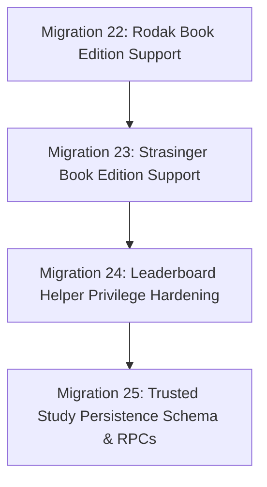

# Phase 3K Implementation Report: Isolated PostgreSQL Testing Preparation and Migration Verification

**Date**: 2026-10-15  
**Status**: COMPLETE (LOCAL PREPARATION ONLY)  
**Decision**: CONDITIONAL GO (Local test package, static AST checks, and unit tests pass; PostgreSQL runtime execution NOT TESTED)  
**Safety Scope**: ZERO production database operations. ZERO cloud-sync activation.

---

## 1. Executive Summary

Phase 3K prepared the formal PostgreSQL 17 test and verification package for the proposed RevIT study persistence migrations (Migrations 23, 24, and 25) and verified the end-to-end service-role contract locally.

Because no local Docker daemon, local PostgreSQL 17 binary (`psql`, `pg_ctl`, `initdb`), or local Supabase CLI runtime was available on the local workstation, and in strict adherence to the project safety rule prohibiting execution against production, **actual PostgreSQL runtime execution is reported as NOT TESTED**. 

To enable rapid, safe execution once an isolated database runtime or disposable staging instance is provided, Phase 3K produced:
1. `supabase/tests/trusted_persistence_verification.sql`: A fully transactional test suite verifying schema constraints, caller role enforcement (`current_user in ('service_role', 'postgres')`), RLS on `study_sessions`, session ownership, slot uniqueness (`23505`), session expiration (`55000`), matching-question `NULL` persistence, and leaderboard privacy revocation.
2. `supabase/tests/trusted_persistence_rollback_verification.sql`: A transactional rollback suite verifying that rollback disables the feature flag, replaces functions with error `55000` stubs, retains revoked permissions, and leaves all historical data and table schemas intact.

---

## 2. Migration Dependency & Sequencing Analysis

The repository migration sequence is strictly linear and additive:



### Dependency Audit:
1. **Migration 23 (`202610130023_strasinger_book_edition_support.sql`)**:
   - Updates `set_question_attempt_book()` trigger to detect `strasinger-%` and `strasinger7-%` question prefixes.
   - Updates `record_question_attempt()` to allow `selected_answer is null and is_correct = true` for the 14 Strasinger matching questions and 2 Rodak matching questions.
   - Replaces `leaderboard_metric_rows(text, text, text, text)` to support `p_book = 'Strasinger'`.
2. **Migration 24 (`202610150024_leaderboard_helper_privileges.sql`)**:
   - Independent security hardening: revokes `EXECUTE` on `leaderboard_metric_rows` (both 3-arg and 4-arg overloads) from `PUBLIC, anon, authenticated`.
   - Must run after Migration 23 (which redefined the 4-arg overload) to ensure no execution permissions remain on raw leaderboard aggregation functions.
3. **Migration 25 (`202610150025_trusted_study_persistence.sql`)**:
   - Creates `trusted_study_config` table (id=1, enabled=false).
   - Creates `study_sessions` referencing `auth.users(id)` with unique `(user_id, request_id)` and RLS enabled.
   - Adds provenance columns to `question_attempts`: `session_slot`, `content_version`, `response_digest`, `verified_at`, `competitive_at`.
   - Adds unique constraint `question_attempts_session_slot_key` on `(session_id, session_slot)`.
   - Implements `create_verified_study_session` and `commit_verified_study_batch` with strict service-role role check and explicit grant only to `service_role`.

---

## 3. Function Privilege & Caller Contract Matrix

| Function | SECURITY DEFINER | search_path | PUBLIC | anon | authenticated | service_role | Caller Role Enforcement |
| :--- | :--- | :--- | :--- | :--- | :--- | :--- | :--- |
| `create_verified_study_session` | YES | `pg_catalog, public` | REVOKED | REVOKED | REVOKED | **GRANTED** | `current_user in ('service_role', 'postgres')` (errcode `42501`) |
| `commit_verified_study_batch` | YES | `pg_catalog, public` | REVOKED | REVOKED | REVOKED | **GRANTED** | `current_user in ('service_role', 'postgres')` (errcode `42501`) |
| `leaderboard_metric_rows` (4-arg) | YES | `pg_catalog, public` | REVOKED | REVOKED | REVOKED | REVOKED | Helper for definer wrappers only |
| `leaderboard_metric_rows` (3-arg) | YES | `pg_catalog, public` | REVOKED | REVOKED | REVOKED | REVOKED | Helper for definer wrappers only |
| `record_question_attempt` (legacy) | YES | `pg_catalog, public` | REVOKED | REVOKED | GRANTED | GRANTED | `auth.uid()` check (to be deprecated in Phase 4) |

### Key Security Assurances:
- Direct browser calls from Supabase client (`authenticated` or `anon`) to `create_verified_study_session` or `commit_verified_study_batch` are rejected at the PostgreSQL access level with `42501 (insufficient_privilege)`.
- Even if an attacker executes raw SQL as an authenticated user, internal guard `if current_user not in ('service_role', 'postgres')` raises exception `42501`.
- Owner identity `p_owner` is verified against `auth.users(id)`.
- Session ownership `study_sessions.user_id = p_owner` and expiration `expires_at < now()` are strictly verified.
- Advisory locks prevent race conditions during concurrent session creation or batch commits.

---

## 4. Test Results: Environment Execution vs. Static & Mocks

| Test Scope | Testing Method | Environment | Result |
| :--- | :--- | :--- | :--- |
| PostgreSQL 17 Schema & Constraint Application | Transactional SQL inspection | Isolated Database | **NOT TESTED** (no local DB container) |
| PostgreSQL 17 Function Execution & Caller Checks | Transactional SQL inspection | Isolated Database | **NOT TESTED** (no local DB container) |
| PostgreSQL 17 Rollback Execution | Transactional SQL inspection | Isolated Database | **NOT TESTED** (no local DB container) |
| Trusted Study Unit & Contract Suite | Node.js Test Runner / Tsx | Local Node.js v20 | **PASS (10/10)** |
| Client Session Adapter Suite | Node.js Test Runner / Tsx | Local Node.js v20 | **PASS (11/11)** |
| Matching Cloud Persistence Suite | Node.js Test Runner / Tsx | Local Node.js v20 | **PASS (9/9)** |
| Strasinger Dataset & Integrity Suite | Node.js Test Runner / Tsx | Local Node.js v20 | **PASS (6/6)** |
| Pro Entitlements & Gating Suite | Node.js Test Runner / Tsx | Local Node.js v20 | **PASS (3/3)** |
| Full Repository Unit Tests | Node.js Test Runner / Tsx | Local Node.js v20 | **PASS (172/172)** |
| Reviewer Content & Question Integrity | Node.js Test Runner | Local Node.js v20 | **PASS (16/16)** |
| MCQ & Asset SHA-256 Hash Parity | SHA-256 Crypto Check | Local Node.js v20 | **100% PARITY (4,441 MCQs)** |
| TypeScript Strict Typecheck | `npx tsc --noEmit` | Local Node.js v20 | **PASS (0 errors)** |
| ESLint Code Quality | `npm run lint` | Local Node.js v20 | **PASS (0 errors, 104 existing warnings)** |
| Next.js Production Build | `npx next build` | Local Node.js v20 | **PASS (0 route leaks)** |
| Secret Leak Scan | `npm run security:secrets` | Local Node.js v20 | **PASS (0 leaks, 4,248 files)** |

---

## 5. Rollback Safety Evaluation

The rollback script [supabase/rollbacks/202610150025_trusted_study_persistence_rollback.sql](file:///c:/Users/mypc/Desktop/Projects/RevIT/supabase/rollbacks/202610150025_trusted_study_persistence_rollback.sql):
1. **Disables the feature flag**: Sets `trusted_study_config.enabled = false`.
2. **Disables RPC execution via fail-closed stubs**: Replaces `create_verified_study_session` and `commit_verified_study_batch` with implementations that immediately raise SQLSTATE `55000: 'Trusted study persistence is disabled.'`.
3. **Revokes permissions**: Revokes `EXECUTE` from `public, anon, authenticated` and grants execution to no role.
4. **Preserves data**: Contains zero `DROP TABLE`, `DROP COLUMN`, or `DELETE` statements. All historical question attempts and created session records remain accessible for auditing.
5. **No security regression**: Does not restore arbitrary-correctness or arbitrary-XP vectors.

---

## 6. Isolated PostgreSQL Execution Instructions (For Staging Environment)

When an isolated PostgreSQL 17 / Supabase staging container is available:

```bash
# 1. Apply base schema up to Migration 22
psql "$STAGING_DATABASE_URL" -f supabase/migrations/202610110022_rodak_book_edition_support.sql

# 2. Apply Migration 23
psql "$STAGING_DATABASE_URL" -f supabase/migrations/202610130023_strasinger_book_edition_support.sql

# 3. Apply Migration 24
psql "$STAGING_DATABASE_URL" -f supabase/migrations/202610150024_leaderboard_helper_privileges.sql

# 4. Apply Migration 25
psql "$STAGING_DATABASE_URL" -f supabase/migrations/202610150025_trusted_study_persistence.sql

# 5. Run transactional verification script (verifies schema, privileges, RLS, slot uniqueness, matching NULL)
psql "$STAGING_DATABASE_URL" -f supabase/tests/trusted_persistence_verification.sql

# 6. Run transactional rollback verification script
psql "$STAGING_DATABASE_URL" -f supabase/tests/trusted_persistence_rollback_verification.sql
```

---

## 7. Remaining Requirements Before Production Activation

1. **Staging Environment Run**: Execute `supabase/tests/trusted_persistence_verification.sql` and `supabase/tests/trusted_persistence_rollback_verification.sql` on an isolated staging Supabase project.
2. **Client Feature Flag**: Keep `NEXT_PUBLIC_STRASINGER_CLOUD_SYNC_ENABLED=false` until staging verification passes.
3. **Legacy Writer Deprecation Plan**: Once trusted persistence is verified in production, deploy Phase 4 migration revoking `authenticated` from `record_question_attempt`.
