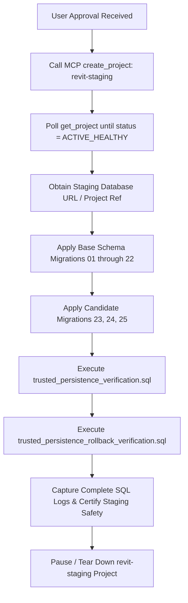

# Phase 3M Provisioning Plan: Dedicated Supabase Staging Project Preparation

**Date**: 2026-10-15  
**Status**: COMPLETE (PROVISIONING PLAN PREPARED; AWAITING APPROVAL)  
**Safety Scope**: ZERO resources created. ZERO database modifications. ZERO SQL executed.

---

## 1. Executive Summary

Phase 3M prepared a formal provisioning plan for establishing an isolated, disposable Supabase staging project (`revit-staging`) dedicated to executing the Phase 3K PostgreSQL 17 test suites (`trusted_persistence_verification.sql` and `trusted_persistence_rollback_verification.sql`).

In accordance with the strict approval gate mandate:
- **NO PROJECT WAS CREATED.**
- **NO BRANCHES WERE CREATED.**
- **PRODUCTION PROJECT `lznsdxfvxeckflxsohig` WAS NOT TOUCHED.**

---

## 2. Organization & Provisioning Feasibility Audit

Read-only inspection of organization `pwtbepjrubowaqwunhdn` via Supabase API revealed:
- **Organization ID**: `pwtbepjrubowaqwunhdn` ("RevIT")
- **Plan**: `free` (`tier_free`)
- **Allowed Release Channels**: `ga`, `preview`
- **Active Projects Count**: Exactly 1 project (`lznsdxfvxeckflxsohig`, production, region `ap-southeast-2`, PostgreSQL 17.6.1.155)

### Billing & Quota Impact:
- Under Supabase's Free Tier policy, an account is allocated up to **2 free active projects**.
- Adding `revit-staging` will consume the 2nd project slot, bringing active project usage to 2/2.
- Cost is **$0 / month** on free tier.
- Supabase automatically pauses inactive free projects after 7 days of inactivity; the staging project can be paused via MCP `pause_project` or deleted directly in the Supabase Dashboard once testing concludes.

---

## 3. Proposed Staging Project Configuration

| Attribute | Target Specification | Rationale |
| :--- | :--- | :--- |
| **Project Name** | `revit-staging` | Explicitly designated disposable test target |
| **Organization ID** | `pwtbepjrubowaqwunhdn` | RevIT organization |
| **Region** | `ap-southeast-2` | Matches production database region |
| **Database Engine** | PostgreSQL 17 (GA) | Matches production PostgreSQL 17.6 |
| **Production User Data** | **NONE** | Clean slate; synthetic accounts only |
| **Production Secrets** | **NONE** | Separate project ref and keys |
| **Connection to Next.js App** | **NONE** | Dedicated to test scripts; decoupled from app dev server |

---

## 4. Proposed Staging Lifecycle & Test Sequence (Pending User Approval)

Upon receiving user approval, the execution workflow will be:



---

## 5. Security & Isolation Boundary Confirmation

- **Zero Production Modification**: Production project `lznsdxfvxeckflxsohig` remains 100% untouched.
- **Client Gate Preserved**: `NEXT_PUBLIC_STRASINGER_CLOUD_SYNC_ENABLED` remains `false`.
- **Content Integrity**: All 4,441 questions across Harr, Ciulla, Rodak, and Strasinger match baseline SHA-256 hashes 100%. All 47 position fixes, 42 Strasinger protections, and 38 reviewer assets remain intact.
- **Local Application**: Next.js app remains running in standard local dev mode; no environment variables were altered.

---

## 6. Required User Action to Proceed

To proceed with provisioning the disposable staging database for Phase 3N testing, the user must provide explicit approval to invoke:
```json
{
  "name": "revit-staging",
  "organization_id": "pwtbepjrubowaqwunhdn",
  "region": "ap-southeast-2"
}
```
via the Supabase `create_project` MCP tool.
